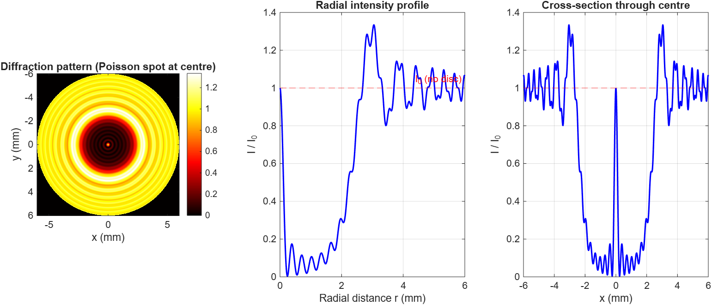
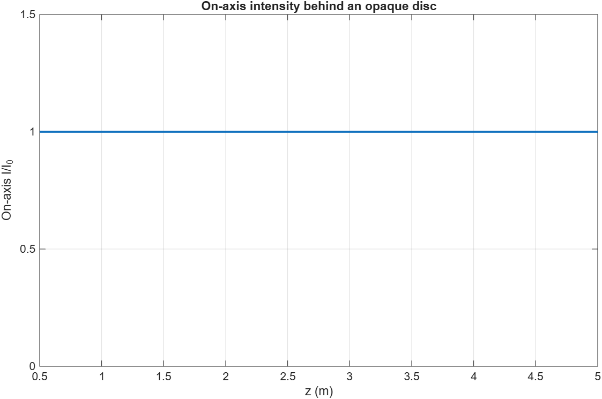

# Diffraction by an Opaque Disc
### Theory and MATLAB Simulation

This project explores Fresnel diffraction by an opaque circular disc and the formation of the **Poisson spot (Arago spot)**, combining the theoretical description of diffraction with numerical simulation in MATLAB.

## Overview

In geometrical optics, an opaque disc placed in the path of a light beam is expected to produce a dark shadow. Wave optics predicts a different result: due to diffraction and interference, a bright spot can form at the centre of the shadow. This phenomenon is known as the **Poisson spot** or **Arago spot**.

## Theoretical Background

The project explores the following concepts:

- Huygens-Fresnel principle
- Fresnel diffraction and Fresnel approximation
- Fresnel half-period zones
- Babinet's principle
- Diffraction by a circular aperture
- The zeroth-order Bessel function in the radial diffraction integral

## Numerical Simulation

The MATLAB implementation evaluates the Fresnel diffraction integral for a circular aperture and uses Babinet's principle to obtain the field behind the complementary opaque disc.

Numerical integration is performed using the trapezoidal rule (`trapz`). The radial intensity distribution is then used to construct a two-dimensional diffraction pattern.

### Simulation Parameters

| Parameter | Value |
|---|---:|
| Wavelength | 632.8 nm |
| Disc radius | 2 mm |
| Disc-to-screen distance | 2 m |
| Fresnel number | Approximately 3.16 |

## Results

### Two-dimensional diffraction pattern and intensity profiles

### Analytical on-axis intensity versus distance

The analytical on-axis result gives a normalised intensity of 1, equal to the unobstructed incident intensity.

## Project Details

**Course:** PH 2102 - Optics and Lasers  
**Institution:** Indian Institute of Technology Patna  
**Guided by:** Prof. Naveen K. Nishchal, Department of Physics, IIT Patna

**Contributors:**
- Shreyas
- Krishna
- Vedant
- Himesh

## My Individual Mathematical Study

Alongside the collaborative implementation, I independently worked through the mathematical reduction of the Fresnel diffraction integral, including its conversion into a radial integral involving the zeroth-order Bessel function. This helped me understand the mathematical basis of the numerical calculation.

## Tools Used

- MATLAB
